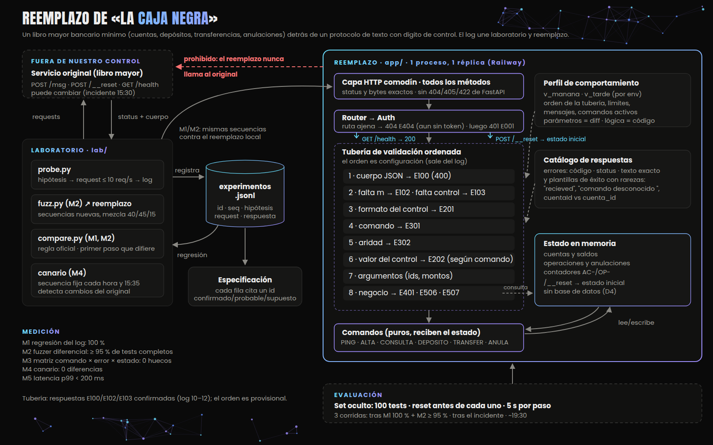

# Diseño: reemplazo de «La caja negra»

Reto 2 del AI Builders Hackathon Frontier BOG 26 · Jaime Aza · 2026-10-10

_Fuente editable: [arquitectura.svg](arquitectura.svg)._

## 1. El problema

Un servicio sin código ni documentación recibe mensajes por `POST /msg` (`{"m": "CMD;arg;…;control"}`) y responde. Hay que **entenderlo por completo y reemplazarlo** de forma que el set de evaluación oficial no distinga el reemplazo del original. Según `MATERIAL.md`, son 100 tests: 40 de un request, 45 secuencias de 2 a 5 y 15 de 6 a 12. Cada test empieza con `POST /__reset` y compara, paso a paso, el status HTTP y el cuerpo. Los JSON se comparan sin orden de claves y el texto, carácter por carácter.

### Qué parece ser el servicio

Por los comandos y las respuestas, el original se comporta como un **libro mayor bancario mínimo** (inferencia **probable**, a partir de los 20 ejemplos y del log):

- **Cuentas**: `ALTA;<nombre>` abre una cuenta con id secuencial `AC-0001`, `AC-0002`… (ejemplos 3–4; log 135–140) y `CONSULTA;<cuenta>` devuelve su saldo, que empieza en 0 (ejemplo 5).
- **Movimientos de dinero**: `DEPOSITO;<cuenta>;<monto>` y `TRANSFER;<origen>;<destino>;<monto>` crean operaciones `OP-0001`… y cambian los saldos (ejemplos 6–8, 10, 18–19).
- **Reglas de riesgo**: un límite por transferencia (120000 da E506, ejemplo 9) y saldo insuficiente (E507, ejemplo 16).
- **Reversión**: `ANULA;<operación>` anula una operación una sola vez; la segunda devuelve `ok:false` (ejemplos 13–14). Los ejemplos indican que **revierte los saldos**: AC-0002 tenía 140000 tras la transferencia OP-0003 de 100000 (ejemplos 8 y 10), después de anularla una transferencia de 50000 falla por saldo insuficiente (ejemplo 16) y su saldo final es 40700 = 40000 + 700 (ejemplo 19). Cómo revierte depósitos y anulaciones encadenadas está por medir.
- **Integridad de trama**: cada mensaje termina en un dígito de control, como en los protocolos bancarios de texto plano de hace años, y `PING` sirve de latido.

Leerlo como un libro mayor orienta las hipótesis (si `ANULA` revierte igual un depósito, si se puede transferir a la misma cuenta, si hay montos negativos o con decimales, si una operación fallida consume un número `OP-`) y la sección de riesgos de la especificación, porque un cliente nuevo no debería heredar sus huecos (riesgos **por investigar**, no comprobados: anulaciones sin restricción, falta de idempotencia, montos sin validar).

Lo que el sistema tiene que resolver, en orden de dificultad:

1. **Integridad.** El último campo es un dígito de control (00–99) que valida el mensaje. Hay que calcularlo exactamente igual. Algunos algoritmos concretos (sumas de bytes, un hash polinómico, CRC y Adler) no reprodujeron los 20 ejemplos en una prueba preliminar fuera del log; es un indicio, no un descarte, y se repetirá con evidencia registrada.
2. **Orden de los errores.** Cuando un mensaje tiene varias fallas a la vez, el original devuelve una sola. `ALTA;Lucia;Gomez;11` responde E302 (aridad), lo que **sugiere** que la aridad se evalúa antes que el valor del control; no está probado porque no sabemos si ese control era inválido. El orden hay que descubrirlo con mensajes de fallas simultáneas conocidas.
3. **Memoria.** Cuentas (`AC-0001`…), operaciones (`OP-0001`…), saldos, anulaciones y límites. Las respuestas dependen de lo que pasó antes en la secuencia.
4. **Rarezas que se copian tal cual**: `"recieved"` mal escrito, `"comando desconocido "` con un espacio al final, `cuentaId` en ALTA frente a `cuenta_id` en CONSULTA, `CONSULTa` aceptado como CONSULTA (ejemplo 11; que valga para todos los comandos es **probable**, no confirmado) y `ANULA` repetida que da 200 con `ok:false`.
5. **Cambio durante el día.** El servicio «puede cambiar» y se evalúa la versión vigente a las 20:00. La agenda oficial del evento marca un **incidente a las 15:30** (fuente: presentación de apertura, no `MATERIAL.md`; lo tratamos como supuesto de planificación).

### Límites

- Presupuesto de exploración: 8.000 requests/día y 10 req/s **por token**. Cada token tiene su propio estado, así que con más integrantes el presupuesto y la exploración en paralelo crecen; el plan (sección 5) está hecho para un token y escala repartiendo frentes.
- Solo **3 corridas** del set oculto (fuente: pestaña Entregas de `/evento`, «0 de 3 corridas usadas»), que además solo dicen cuántos tests pasan.
- 5 s por paso. El reemplazo no puede llamar al original.
- Los 20 ejemplos se grabaron «con la versión de la mañana».

### Supuestos (los marco porque pueden ser falsos)

| # | Supuesto | Cómo lo verifico |
|---|---|---|
| S1 | El dígito de control es una función pura del texto del mensaje: no depende del token, de la hora ni del estado. | **Probable.** Confirmado solo para los mensajes probados: `ALTA;Lucia;82` es válido dos veces seguidas y otra vez tras un reset, `ALTA;Lucia;83` da E202 y `ALTA;Mateo;3` es válido, igual que en los ejemplos 2–4 que grabó la organización (log 135–137, 139–140). PING no valida el valor del control (log 13–127). Falta confirmarlo en los demás comandos. |
| S2 | `__reset` deja el estado exactamente como al inicio: el primer ALTA da `AC-0001` y la primera operación `OP-0001`. | **Confirmado para cuentas:** ALTA → ALTA → reset → ALTA da `AC-0001`, `AC-0002` y de nuevo `AC-0001` (log 135, 136, 139); `__reset` responde 200 `{"ok":true}` (log 134, 138). Para operaciones (`OP-0001`) es **probable** (ejemplo 6). |
| S3 | El set oculto usa los mismos comandos y errores que se pueden descubrir con exploración. | Barrido de nombres de comandos cuando se conozca el control. |
| S4 | El incidente de las 15:30 cambia el comportamiento del servicio (no sabemos cuánto). | Canario y re-corrida completa del log a las 15:35. |

### Casos difíciles

- **Mensajes con varias fallas** (control y aridad, comando desconocido y control, cuenta inexistente y monto inválido): solo se replican si se conoce el orden exacto.
- **Valores límite y «feos»**: montos cerca del límite (120000 se rechaza con E506; el límite exacto es desconocido), 0, negativos, decimales, ceros a la izquierda, espacios, minúsculas en el id de cuenta, campos vacíos (`PING;;64`) y números enormes.
- **Interacciones de memoria**: anular una operación que dejó otra cuenta sin saldo, transferirse a uno mismo, anular un depósito frente a anular una transferencia, y contadores que avanzan (o no) cuando una operación falla.
- **Entrada fuera de `/msg`**: rutas inexistentes, métodos incorrectos, cuerpo que no es JSON, `{}` y `m` vacío. Esos cuerpos de error tienen que coincidir, incluido el texto plano si lo hay.
- **Auth y rutas**: a cualquier token que no sea el del equipo el reemplazo le responde lo mismo que el original da a un token inválido, y el orden importa: `/noexiste` da 404 incluso sin token (log 141; para otras rutas, probable), pero una ruta existente sin token da 401.

### Lo que dejo fuera, con razón

| Fuera | Por qué |
|---|---|
| Rate limit y header `X-Frontier-Infra` | Son de la infraestructura del evento, no del servicio (lo dice el material). |
| Estado separado por token | El reemplazo solo atiende el token del equipo. En las rutas reconocidas, cualquier otro recibe el 401 del original y no toca estado; las rutas inexistentes dan 404 igual que en el original. |
| Headers (`X-Req` y otros) | El set no compara headers. `X-Req` se comporta como un contador de los `POST /msg` con token válido que siguió subiendo tras un reset (log 10–12, 128–133; **probable**). Lo replico como **supuesto** porque cuesta una línea y sirve para depurar. |
| LLM dentro del reemplazo | Ver D1. |

## 2. Arquitectura

Son dos sistemas: el **laboratorio**, que descubre el comportamiento y lo mide, y el **reemplazo**, que lo reproduce. Los une el **log de experimentos**, que a la vez es evidencia de la especificación, suite de regresión y fuente de los casos del fuzzer.

**Laboratorio** (`lab/`)
- `probe.py`: cliente del original. Respeta los 10 req/s y registra cada request, incluidos los `__reset`, en `experimentos.jsonl` con su hipótesis, la ruta, el método y la variante de auth.
- Exploraciones por hipótesis, agrupadas en secuencias `seq` que siempre empiezan con un reset.
- `fuzz.py`, el **fuzzer diferencial**. Un *fuzzer* es un programa que genera muchas entradas automáticas y variadas para encontrar casos que nadie habría escrito a mano. Es *diferencial* porque no conocemos la respuesta correcta de antemano: la verdad es lo que contesta el original, y medimos en qué difiere el reemplazo. Inventa secuencias al azar con la mezcla oficial (por ejemplo `ALTA` → `DEPOSITO` → `ANULA` → `CONSULTA`), las corre contra los dos y compara paso a paso. Busca errores **en nuestro reemplazo**.
- `compare.py`: el comparador oficial (JSON sin orden de claves, arrays en orden, texto exacto si no es JSON). Reporta el primer paso que difiere y por qué.
- El **canario**: una secuencia corta y fija, cuyas respuestas ya conocemos, que se manda al original cada hora. Es una alarma temprana (el nombre viene del canario que los mineros bajaban para detectar gas): si devuelve algo distinto a lo grabado, el servicio cambió. Vigila cambios **en el original**, no errores del reemplazo.

**Reemplazo** (`app/`, un proceso)
1. **Capa HTTP comodín.** Una sola ruta `/{path}` para todos los métodos, que devuelve status y bytes exactos. `/health` y `/__reset` se despachan dentro de ella.
2. **Router, luego auth.** Primero se resuelve la ruta: `/noexiste` da 404 `{"error":"E404","mensaje":"ruta desconocida"}` **aunque no haya token** (`GET`, log 141) **o sea inválido** (`POST`, log 142); que valga para cualquier ruta inexistente es **probable** y es la regla que sigue el reemplazo y también con token válido (log 7, 8); `GET /msg` da el mismo 404 con token válido (log 9; sin token es **supuesto**). En las rutas que existen, si no es el token del equipo, devuelve 401 `{"error":"E001","mensaje":"no autorizado"}` (probado sin token y con token inválido en `GET /health` y `POST /msg`, log 1, 2, 4, 5, y sin token en `POST /__reset`, log 6). Con token válido: `GET /health` → 200 `{"ok":true}` (log 3), `POST /__reset` → 200 `{"ok":true}` y estado inicial (log 134), `POST /msg` → tubería. `PUT`, `DELETE` y la raíz son **supuesto** hasta probarlos.
3. **Tubería de validación ordenada**: cuerpo JSON (E100) → falta `m` (E102) → falta control (E103) → formato del control (E201) → comando (E301) → aridad (E302) → valor del control (E202, que **depende del comando**: PING no validó ningún control numérico probado) → argumentos → reglas de negocio. El **orden es configuración**: sale de los experimentos y se cambia en un solo lugar. Las respuestas E100, E102 y E103 están confirmadas una a una (log 10–12); su precedencia relativa y el resto del orden son **provisionales** hasta probar fallas simultáneas.
4. **Comandos** como manejadores puros `(estado, args) → (status, cuerpo, estado')`. Las etapas de argumentos y negocio **reciben el estado** (para saber si una cuenta existe o si alcanza el saldo).
5. **Catálogo de respuestas** como datos: código, status y texto exacto de cada error, y las plantillas de las respuestas de éxito con sus rarezas (`recieved`, `cuentaId`/`cuenta_id`).
6. **Estado en memoria**: cuentas, operaciones, contadores y anulaciones. `__reset` lo reemplaza entero por el estado inicial. **Atomicidad:** el manejador es `async def`, lee el cuerpo completo antes de tocar el estado y después ejecuta validación, transición (o reset) y construcción de la respuesta **sin ningún `await` ni traslado a hilos** en esa sección. En el event loop de un único worker eso hace la sección indivisible: dos requests nunca intercalan cambios. Bajo esa condición se descarta un lock (no añade nada); si algún día hubiera un `await` dentro, el lock pasaría a ser obligatorio.
7. **Perfil de comportamiento** (`v_manana`, `v_tarde`), que se elige por variable de entorno y fija el orden de la tubería, los límites, los mensajes y los comandos activos. Si el incidente cambia algo parametrizable (orden, límites, mensajes, comandos activos), el arreglo es un diff de configuración; si cambia lógica, se modifica el manejador y debe pasar M1 y M2 antes de desplegar.

**Despliegue:** Railway, un servicio con **1 réplica** y `uvicorn` con un solo worker. **Disponibilidad:** `/health` exige token (log 1–2), y el health check de Railway no envía credenciales, así que **no se configura health check de plataforma**; la disponibilidad se verifica después de cada despliegue con un script que llama `GET /health` con `Authorization: Bearer <TEAM_TOKEN>` y espera 200 `{"ok":true}`. Alternativas descartadas: abrir `/health` sin token (contradice log 1–2 y el contrato «sin token responde como el original») y crear una ruta pública extra (el original responde 404 `E404` a `/noexiste` sin token, log 141, y el reemplazo generaliza esa regla; una ruta extra que responda 200 rompería esa equivalencia).

## 3. Decisiones y alternativas descartadas

| # | Decisión | Alternativa descartada | Por qué |
|---|---|---|---|
| D1 | Motor **determinista** en Python | LLM que imite respuestas, o híbrido con LLM para lo desconocido | La comparación es exacta, hay que calcular un control y contadores, y hay 5 s por paso. Un LLM no es determinista, agrega latencia y costo, y no puede inventar un control válido. Lo desconocido va a un **supuesto** documentado. |
| D2 | **Ruta comodín** que devuelve bytes exactos | Rutas tipadas de FastAPI con modelos Pydantic | FastAPI genera sus propios 404, 405 y 422 (`{"detail": …}`), que no coinciden con los del original. Confirmado: el original responde a un método incorrecto con 404 `E404`, no con 405 (log 9), y a un JSON inválido con 400 `E100`, no con 422 (log 10). |
| D3 | **Tubería ordenada y configurable** con catálogo de errores como datos | `if` dentro de cada comando | El orden de los errores es lo que más se equivoca y lo que el incidente puede cambiar. Así se reordena sin tocar los comandos, y cada etapa se prueba sola. |
| D4 | **Estado en memoria**, 1 proceso y 1 réplica | SQLite o Redis | Cada test empieza con reset, así que no hace falta persistir. Una base agrega latencia y fallas. El riesgo de que haya varias instancias (cada una con su estado) se cierra fijando 1 réplica. |
| D5 | **Perfiles por versión** del servicio | Un solo comportamiento que se edita en sitio | Se puede volver atrás, comparar la mañana con la tarde y documentar el cambio con evidencia. |
| D6 | **Log como única fuente de verdad** (evidencia, regresión y semillas del fuzzer) | Notas sueltas con tests escritos a mano | La especificación cita `id` del log y la suite reproduce exactamente esos casos registrados: cada afirmación concreta queda probada; las generalizaciones se marcan probable o supuesto. |
| D7 | **Lo transversal primero**: control y orden de errores antes de afinar cada comando | Ir comando por comando | El control y el orden de los errores afectan a todos los requests de todos los comandos. Si se afina cada comando antes de conocerlos, el modelo puede explicar todo lo observado y aun así fallar en la mayoría de los casos nuevos. |
| D8 | Python, FastAPI/Starlette y uvicorn en Railway | Node, o Vercel serverless | Es el stack del laboratorio, así que comparten el comparador y los datos. Serverless tiene arranques en frío y varias instancias sin estado compartido, y eso rompe la memoria entre pasos. |

## 4. Plan para medir

La métrica **no** es el log: un modelo puede pasar el 100 % de lo que vio y fallar en lo que no vio. Por eso medimos con **secuencias nuevas**.

| Medición | Qué es | Métrica y umbral |
|---|---|---|
| **M1. Regresión del log** | Se repite cada `seq` de `experimentos.jsonl` contra el reemplazo local: reset al inicio de la `seq`, mismo método, ruta y variante de auth (sin token o inválido se mandan igual; el token propio se sustituye por el del equipo) y el cuerpo exacto: JSON, o **texto crudo** cuando el log lo registra como texto (log 10). Los 20 ejemplos van como una sola secuencia tras un reset. `X-Req` no se compara. Desde ahora `probe.py` registra cada `__reset` como fila y marca cada fila con `body_mode` (`json` o `raw`) y los headers enviados, que M1 reproduce (incluido el Content-Type). `send()` y `reset()` son la única interfaz de exploración; `raw()` es transporte interno. Las respuestas de infraestructura (rate limit) se registran como fila marcada `infra` antes de reintentar y quedan fuera de M1. Los requests sin cuerpo (`GET`, `__reset`) llevan `body_mode: none`. Las 133 filas anteriores no se reescriben: la 10 es `raw` con `Content-Type: application/json`, las que tienen `request: null` (salud, rutas y resets) van **sin cuerpo** (`none`) y el resto es JSON; sus resets no tienen fila y no se les inventa un `id`. | 100 % de pasos iguales antes de cada despliegue. |
| **M2. Fuzzer diferencial** | **Lotes de 100 tests inéditos** con la mezcla del set oficial (40 de 1 paso, 45 de 2 a 5 y 15 de 6 a 12), generados con una **semilla guardada** para poder repetirlos. Cuotas por paso: ~50 % mensajes válidos (los seis comandos representados, PING ≤ 10 %), ~25 % fallas de entrada e integridad (control, aridad, comando, cuerpo) y ~25 % errores de negocio (cuenta inexistente, saldo, límite, anulación repetida). Corren contra el original (y se registran) y contra el reemplazo. Tras cada arreglo se confirma con una **semilla nueva**, para no ajustar el reemplazo a un lote. Cada lote cuesta entre 320 y 545 requests al original (incluidos los 100 resets, según las longitudes); se carga el conteo real a la cuota. Las llamadas al reemplazo no cuentan. | Tasa de **tests completos** que coinciden, desglosada por comando y por error. Puerta interna para gastar una corrida oficial: ≥ 95 %. Es una coincidencia empírica bajo esa distribución, no una garantía del puntaje oculto. |
| **M3. Matriz de cobertura** | Comando × cada error × estado relevante, con valores límite y «feos». | 0 celdas vacías. Se reporta por separado cuántas celdas son **confirmadas** (citan un `id`), **probables** y **supuestos**; un supuesto nunca cuenta como evidencia. Meta: ≥ 90 % confirmadas a las 20:00. |
| **M4. Canario** | Secuencia fija de ~15 pasos contra el original, cada hora y a las 15:35. | 0 diferencias. Si aparece una, se re-corre M1 completo contra el original y se crea el perfil `v_tarde`. |
| **M5. Latencia** | p99 por paso en el reemplazo desplegado. | < 200 ms, muy por debajo de los 5 s. |

**Casos de prueba que ya hay desde el diseño:** los 20 ejemplos oficiales (M1); `ALTA;Lucia;Gomez;11` → E302 (indicio del orden aridad/control); `TRANSFER … 120000` → E506 (límite); `ANULA` repetida → 200 con `ok:false`; `CONSULTa` → 200; `SALDOS` → E301 con el espacio al final.

**Uso de las 3 corridas oficiales:** son confirmaciones, no diagnóstico: solo dicen cuántos tests pasan, no por qué falla cada uno.
1. Cuando M1 esté al 100 % y M2 al 95 % con la versión de la mañana.
2. Después de adaptar el reemplazo al incidente.
3. Hacia las 19:30, después del último canario.

### Cómo se entrega lo aprendido

La especificación sigue las siete secciones de `MATERIAL.md` (Entrada, Integridad, Comandos, Memoria entre requests, Errores, Cambios durante el día, Riesgos), con una tabla `ID | Comportamiento | Evidencia | Confianza` en cada una. Cada fila cita `id` del log y se marca **confirmado**, **probable** o **supuesto** con el mismo criterio que este documento. La matriz M3 es la lista de filas que hay que llenar.

## 5. Plan del día y presupuesto

| Hora | Bloque | Requests |
|---|---|---|
| 10:30–12:00 | Diseño y exploración corta (entrada, control y `X-Req`) | ~150 |
| 12:00–14:00 | Control e integridad, orden de errores y matriz de cobertura | ~2.500 |
| 14:00–15:30 | Reemplazo, M1 y M2 de la mañana, despliegue y corrida oficial 1 | ~1.500 |
| 15:30–17:30 | Incidente: canario, re-mapeo, perfil `v_tarde` y corrida oficial 2 | ~1.500 |
| 17:30–20:00 | Especificación, riesgos, video y corrida oficial 3 | ~1.000 + reserva |

## 6. Riesgos

| Riesgo | Mitigación |
|---|---|
| No se descubre el algoritmo del control | Barridos sistemáticos (variar un carácter a la vez). Si no sale, se usa una tabla de controles observados para los mensajes frecuentes y se documenta como **supuesto**. |
| El incidente cambia algo que no detecta el canario | Re-corrida **completa** del log, no solo del canario, a las 15:35 y a las 18:30. |
| La plataforma levanta varias instancias | Fijar 1 réplica y 1 worker, y verificarlo con dos `ALTA` seguidas en el entrypoint desplegado. |
| El presupuesto se va en un solo frente | Reparto por bloques (sección 5) y la regla de lo transversal primero (D7). |
| Afirmaciones falsas en la especificación (restan) | Cada fila cita un `id`. Lo no probado se marca **supuesto**, nunca **confirmado**. |

## 7. Hallazgos de la exploración inicial

Antes de cerrar el diseño hice 142 experimentos (secuencias `d1-entrada`, `d2-control`, `d2-control-b`, `d3-xreq`, `d3-xreq-b`, `d4-estado` y `d4-estado-b`), enfocados en las preguntas que podían cambiar la arquitectura.

| Hallazgo | Evidencia (log) | Qué cambia en el diseño |
|---|---|---|
| `GET /health` y `POST /msg` dan 401 sin token y con token inválido; `POST /__reset` da 401 sin token (con token inválido no se probó). Cuerpo: `{"error":"E001","mensaje":"no autorizado"}`. Pero `/noexiste` da 404 `E404` sin token (`GET`) y con token inválido (`POST`). | 1, 2, 4, 5, 6, 141, 142 | **El router va antes que la auth** (en lo probado). Corrige una elección inicial del diseño que suponía lo contrario. |
| `ALTA` valida el control de forma estable: el mismo mensaje es válido en repeticiones y tras un reset, el control de los ejemplos de la organización sirve igual, y un control distinto da E202. Tras un reset las cuentas vuelven a `AC-0001`. | 135–137, 139, 140 | Respalda S1 (probable) y confirma S2 para el contador de cuentas: el reemplazo trata el control como función pura del texto. |
| `GET /noexiste`, `POST /noexiste` y `GET /msg` dan 404 `{"error":"E404","mensaje":"ruta desconocida"}`. No hubo 405. | 7, 8, 9 | Confirma D2 (ruta comodín). `PUT`, `DELETE` y la raíz quedan por probar. |
| Un cuerpo que no es JSON da 400 `E100 "json inválido"`, `{}` da `E102 "falta m"` y `{"m":""}` da `E103 "falta control"`. | 10, 11, 12 | Fija las respuestas de las primeras etapas. «Falta control» con `m` vacío **sugiere** que el control se busca antes que el comando; su precedencia exacta es provisional. |
| `GET /health` con token válido da 200 `{"ok":true}`. | 3 | El contrato de `/health`. |
| **PING aceptó todos los controles numéricos probados** (00–99 en 13–112, 0–9 en 118–127) y responde igual entre repeticiones (113–117). Letras, vacío y números fuera de rango no se probaron. | 13–127 | Validar el valor del control **depende del comando**: es un atributo de cada comando en el perfil. El algoritmo se busca con ALTA, que sí valida el valor (ejemplo 2: E202). DEPOSITO valida al menos el formato (ejemplo 17: E201). |
| `X-Req` sube de uno en uno en los `POST /msg` con token válido, incluidos los errores de validación; los 401 y 404 no traen el header. Siguió subiendo después de un reset. | 10–12, 128–133 | **Probable**: que sea por token y que los 401 no lo incrementen no se comparó. Como el set no compara headers, se replica como supuesto. |

**Preguntas abiertas que salen de aquí:** el algoritmo del control (con comandos que sí validan); el orden entre E201, E301, E302 y E202 (el ejemplo 20 sugiere que la aridad va antes que el valor del control); si `PUT` o `DELETE` sobre rutas conocidas también dan E404; y si los campos vacíos o los espacios cuentan para la aridad.
